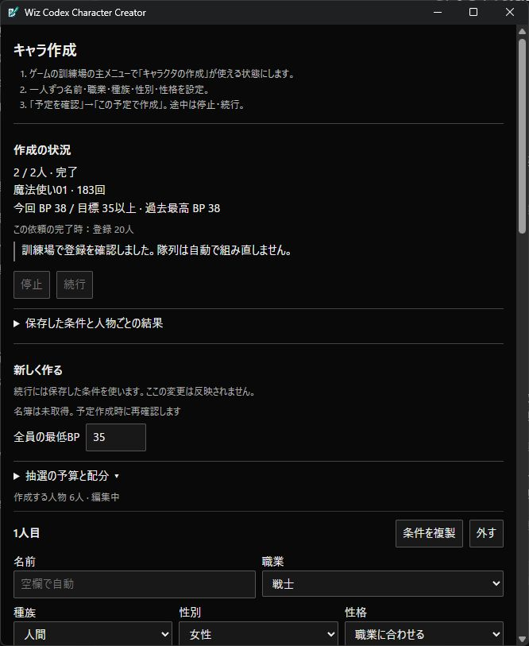

# 🪶 Wiz Codex Character Creator

A Windows companion for creating characters in the Training Grounds in *Wizardry: The Five Ordeals* on Steam.

[Download / ダウンロード](https://github.com/wiztailworks/wiz_codex/releases/tag/creator-v1.0.0)

## 🚀 Quick Start

🌐 Use the menu in the top-right corner to switch between Japanese and English. Creator remembers your choice.

1. Extract the entire ZIP and run **Wiz Codex Setup.exe**. Install it in its own folder, then run **WizCodexCharacterCreator.exe**.
2. In the game, open the Training Grounds with room for a new character. Set the character details, minimum bonus points (BP), and roll limit in Creator.
3. Review the plan and start. Keep the game in the foreground. When you're done, form your party and save in the game.

To update an existing installation, close Creator and select its current folder in Setup.

The roll limit can be reached before your BP target comes up. You can stop a run from Creator.

## 日本語

🌐 右上のメニューで日本語・英語を切り替えられます。選んだ言語は次回も使えます。

Steam版『Wizardry外伝 五つの試練』の訓練場で、BPの抽選・能力配分・キャラクター登録を手伝うWindows用ツールです。

1. ZIPをすべて展開して **Wiz Codex Setup.exe** を実行。Wiz Codex本体とは別のフォルダに導入し、**WizCodexCharacterCreator.exe** を開きます。
2. ゲームで名簿に空きのある訓練場を開きます。Creatorでキャラの設定、最低BP、抽選上限を決めます。
3. 「予定を確認」から作成を開始し、ゲームを前面に置きます。完了したらゲームで必要に応じて隊列を組み、保存します。

更新する場合はCreatorを閉じ、セットアップで現在の導入先を選びます。

抽選上限までに希望のBPが出ないこともあります。作成はCreatorの「停止」で止められます。
