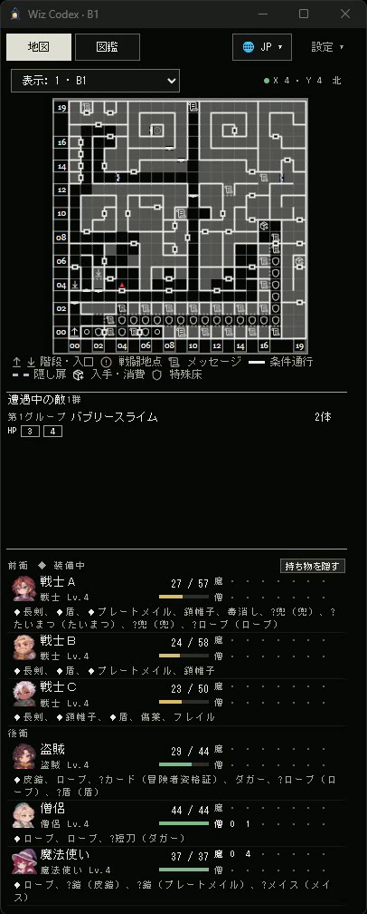

# Wiz Codex

A little help for your adventures in *Wizardry: The Five Ordeals* (Steam / Windows).

> Steam版『Wizardry外伝 五つの試練』の冒険をちょっと便利にする、Windows用の非公式ツールです。

[↓ Downloads](#downloads)

## 💡 Features at a Glance

- **Auto-connect** — Load a save and Wiz Codex starts showing your game info.
- **Map & battle** — Keep the map, enemy HP, and inventory beside the game.
- **Unidentified items** — Enable item names in Settings to see what you picked up.
- **Monster & item guides** — Look up weaknesses, special attacks, item effects, and chest drops.

> 迷宮探索のお供に。セーブを開けば自動でつながり、地図や敵HPをゲームの横に出しておけます。未鑑定品の名前は設定で表示。敵の弱点や宝箱のドロップは図鑑で。

  
  
  

## Downloads

- 🧭 [**Wiz Codex — Windows ZIP**](https://github.com/wiztailworks/wiz_codex/releases/download/v2.0.0/WizCodex-Windows-x64.zip)
- 🪶 [**Character Creator — Windows ZIP**](https://github.com/wiztailworks/wiz_codex/releases/download/creator-v1.0.0/WizCodex-Character-Creator-Windows-x64.zip)

[Wiz Codex quick start](#quick-start) · [Character creation & BP rerolls](creator.md) · [日本語のセットアップ](#日本語)

## Quick start

Unzip everything, run **Wiz Codex Setup.exe**, then open **WizCodex.exe**. Load a save in the Steam game and Wiz Codex connects on its own.

Use 🌐 to switch languages. For enemy HP, turn on **Enemies** in Settings.

### 日本語

ZIPを全部展開して **Wiz Codex Setup.exe** を実行。**WizCodex.exe** を開いてゲームでセーブを読み込むと、自動でつながります。

🌐 で日本語に切り替え。敵HPは設定の「敵」をオンにすると見られます。

Setup notes / インストールの補足

Windows x64, Edge WebView2 Runtime and .NET Framework 4.6.2+ are required. Python is included. Setup is unsigned. When updating, close Wiz Codex and select its current install folder.

更新するときはWiz Codexを閉じて、今のインストール先を選んでください。

[Legacy tools](docs/LEGACY.md) · [MIT License](LICENSE)
