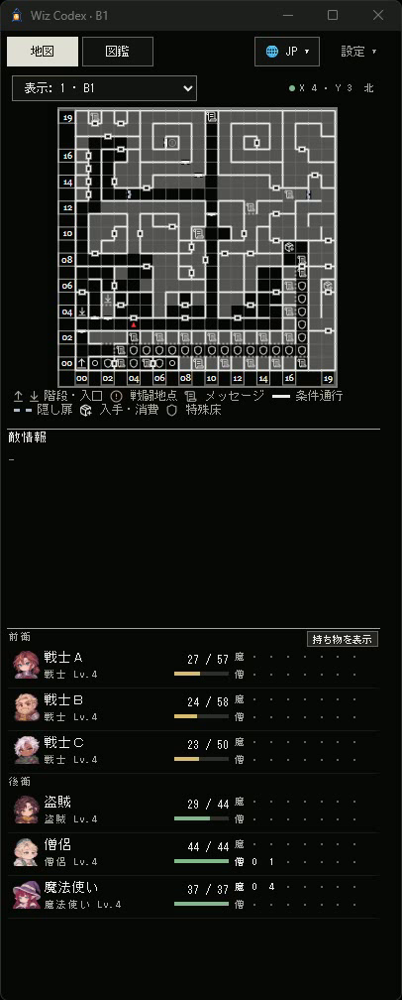
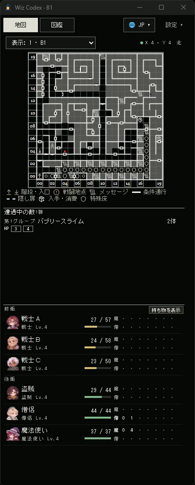
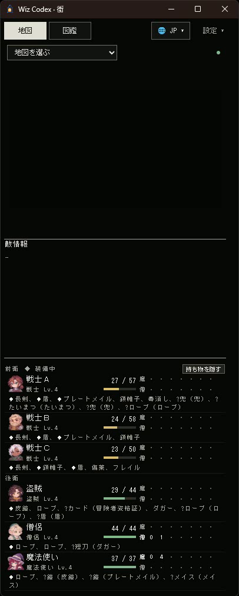
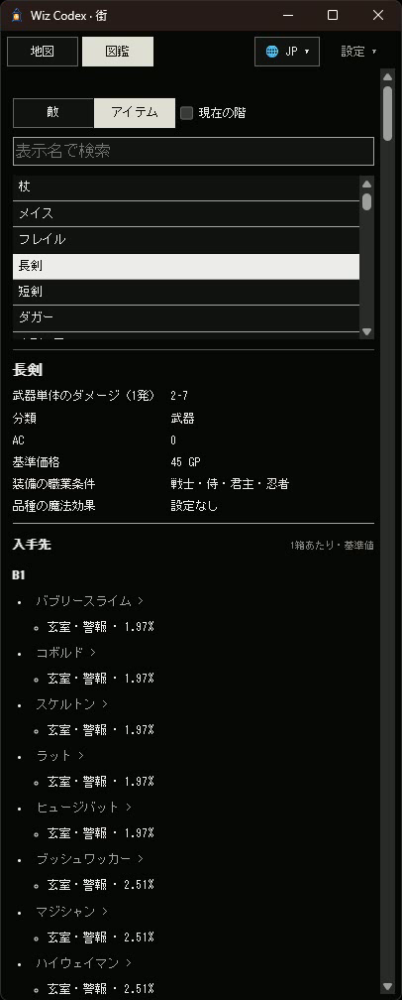

# Wiz Codex

A little help for your adventures in *Wizardry: The Five Ordeals* (Steam / Windows).

Steam版『Wizardry外伝 五つの試練』の冒険をちょっと便利にする、Windows用の非公式ツールです。

- 🧭 **Wiz Codex** · Map, enemy HP & reference / 地図・敵HP・図鑑 · [Windows ZIP](https://github.com/wiztailworks/wiz_codex/releases/download/v2.0.0/WizCodex-Windows-x64.zip) · [Release](https://github.com/wiztailworks/wiz_codex/releases/tag/v2.0.0)
- 🪶 **Character Creator** · Character creation & BP rerolls / キャラ作成・BP厳選 · [Windows ZIP](https://github.com/wiztailworks/wiz_codex/releases/download/creator-v1.0.0/WizCodex-Character-Creator-Windows-x64.zip) · [Guide / 使い方](creator.md)

[日本語のセットアップ](#日本語)

## Quick start

1. Download the **Wiz Codex Windows x64 ZIP** from [Releases](https://github.com/wiztailworks/wiz_codex/releases/latest) and extract all files. Keep the `product` and `runtime` folders next to **Wiz Codex Setup.exe**.
2. Run **Wiz Codex Setup.exe** and choose the suggested location or an empty folder. To update Wiz Codex, close it first and select its existing installation folder. Click **Install**.
3. After installation, choose **Open folder** and run **WizCodex.exe**. Load a save in the Steam game and wait for Wiz Codex to connect.

Requires Windows x64, Microsoft Edge WebView2 Runtime, and .NET Framework 4.6.2 or later. Python is included. The installer is unsigned. The release includes `SHA256SUMS.txt` for verifying the ZIP.

## What you can see

Keep Wiz Codex beside the game. It shows what’s happening as you play and leaves your save untouched.

- **Map.** Check your floor, coordinates, and facing. Browse another floor, then choose **Follow** to bring the map back to your party.
- **Battle.** Check which enemies are present. Turn on **Enemies** under **Settings → Book of Wisdom** to see each enemy's remaining HP when available.
- **Party and inventory.** Check your party's HP, status, and available spell charges. Choose **Show inventory** to see each member's items. ◆ marks equipped items.
- **Reference.** Look up enemy stats and encounter locations, item damage and effects, and possible loot sources. If the reference lists a chest drop rate, it is the baseline chance per chest.

The 🌐 menu switches between English and Japanese. Reference entries use their original names if an English name is unavailable.

*The red arrow marks the party's position and facing. 赤い矢印はパーティーの現在地と向きを示します。*

*Remaining HP for each enemy. 敵1体ごとの残りHP。*

*Inventory by party member. 仲間ごとの持ち物。*

*Bubbly Slime's HP range and armor class (AC) in the reference. 敵図鑑のバブリースライム。HPの範囲とACを確認できます。*

*The Long Sword's damage and the classes that can equip it. アイテム図鑑の長剣。ダメージと装備できる職業を確認できます。*

## Good to know

- Wiz Codex follows the scenario loaded in the game. Reference details can vary by scenario and may take a moment to update after a switch.
- A dash (—) marks a value that is temporarily unavailable. For example, party HP can show a dash while you decide how to respond to a friendly encounter.
- Wiz Codex retrieves game information locally. It sends no game input and makes no changes to game memory or save files.
- See [Legacy tools](docs/LEGACY.md) for Mapbook and Lifebook.

## 日本語

**Wiz Codex** は、Steam版『Wizardry外伝 五つの試練』向けの非公式・読み取り専用ツールです。ゲームの横に開いておけば、探索中の現在地や仲間の状態を見ながら、敵やアイテムを調べられます。

### 導入と起動

1. [Releases](https://github.com/wiztailworks/wiz_codex/releases/latest) から **Wiz CodexのWindows x64版ZIP** をダウンロードし、すべて展開します。`product` と `runtime` は **Wiz Codex Setup.exe** と同じ場所に置きます。
2. **Wiz Codex Setup.exe** を起動し、表示された導入先か空のフォルダを選びます。更新する場合は、Wiz Codexを閉じてから、今使っている導入先を選んでください。「導入・更新」を押すとインストールが始まります。
3. 導入が終わったら「フォルダを開く」から **WizCodex.exe** を起動します。Steam版のゲームでセーブデータを開き、Wiz Codexが接続するまで待ちます。

動作にはWindows x64、Microsoft Edge WebView2 Runtime、.NET Framework 4.6.2以上が必要です。Pythonは同梱しています。インストーラーは未署名です。ZIPの照合には、同時配布する `SHA256SUMS.txt` を使えます。

### 見られる情報

- **地図** ─ 現在の階・座標・向きが分かります。別の階を見たあと、「現在地へ」を押すと地図の表示がパーティーの現在地に戻ります。
- **戦闘** ─ 出現した敵を確認できます。「設定」→「叡智の書」で「敵」を有効にすると、敵1体ごとの残りHPを、取得できたときに表示します。
- **仲間と持ち物** ─ HP、状態、取得できた呪文の残り回数を表示します。「持ち物を表示」で仲間ごとの所持品が開きます。◆は装備中の印です。
- **図鑑** ─ 敵の能力や出現場所、アイテムのダメージや効果、入手候補を調べられます。宝箱からの入手確率が分かる品は、宝箱1個あたりの基準値を表示します。

🌐 メニューで日本語と英語を切り替えられます。英名が用意されていない図鑑項目は元の名前で表示します。

### 補足

- ゲームで開いたシナリオに追従します。図鑑の内容はシナリオによって異なり、切り替え後の更新に時間がかかることがあります。
- 「—」は一時的に値を取得できていない項目です。たとえば友好的な敵への対応を選んでいる間は、味方HPが「—」になることがあります。
- ゲーム情報はPC内で読み取ります。ゲームの操作や、ゲームのメモリ・セーブデータへの書き込みは行いません。
- 旧Mapbook・Lifebookの案内は [旧版ツール](docs/LEGACY.md) を参照してください。

## License / ライセンス

Wiz Codex is available under the [MIT License](LICENSE). Third-party notices are included in the ZIP.

Wiz Codexは [MITライセンス](LICENSE) です。同梱ライブラリのライセンスはZIP内の案内をご覧ください。
